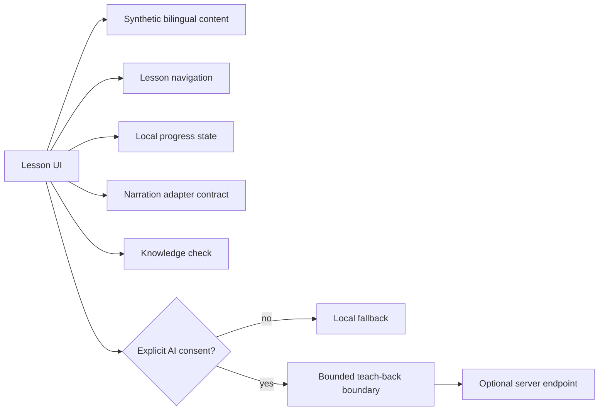

# Sleep Education App Portfolio

> A sanitized demonstration application exploring accessible, bilingual patient education for obstructive sleep apnea and PAP therapy.

## Scope and disclaimer

This is a portfolio demonstration created to show software and product-learning work. It is not affiliated with or endorsed by any healthcare organization, research group, laboratory, or clinical partner. It is not a production clinical application, does not provide medical advice, contains synthetic demonstration content only, contains no patient or research data, and makes no claim of clinical effectiveness.

## Problem

Health-education interfaces should be understandable, accessible, and usable when attention, language preference, device capability, and connectivity vary. This small public edition demonstrates the control points that make those requirements inspectable without shipping clinical records or real educational material.

## My role in this edition

I independently implemented the public portfolio application's TypeScript domain contracts, synthetic lesson set, progress model, navigation, narration contract, knowledge-check behavior, consent boundary, error handling, tests, and neutral demonstration UI. The public edition does not claim ownership of any material outside this repository.

## Demonstrated features

- English/Spanish module and screen identifier parity.
- Synthetic lesson navigation and single-choice knowledge checks.
- Immutable progress transitions with local serialization and restoration contracts.
- A narration cue contract that can feed a platform speech adapter.
- Consent-gated AI teach-back with bounded input and a no-request-before-consent test.
- Offline-safe local fallback when consent is absent or a service is unavailable.
- Explicit privacy, accessibility, translation, and clinical-review limitations.

## Architecture



## Run it

From this repository directory:

```powershell
npm.cmd ci
npm.cmd run check
```

The checks are deterministic and do not contact a network.

## Privacy and safety

Read [PRIVACY.md](PRIVACY.md), [SECURITY.md](SECURITY.md), and [DISCLAIMER.md](DISCLAIMER.md). Consent is enforced at the request boundary; the public test suite proves that a request function is not invoked before consent. No credentials, accounts, analytics, patient data, research data, or remote content are included.

## Bilingual QA

The validator compares ordered module and screen identifiers, checks locale markers, requires synthetic markers, and requires the exact English or Spanish demonstration notice on every screen. This is a parity check, not proof of professional translation quality.

## Limitations

This edition does not claim clinical validation, deployment, patient use, health outcomes, or production equivalence. Native speech, device storage, accessibility automation, visual regression, professional translation review, and clinical review remain future work for a real product.
