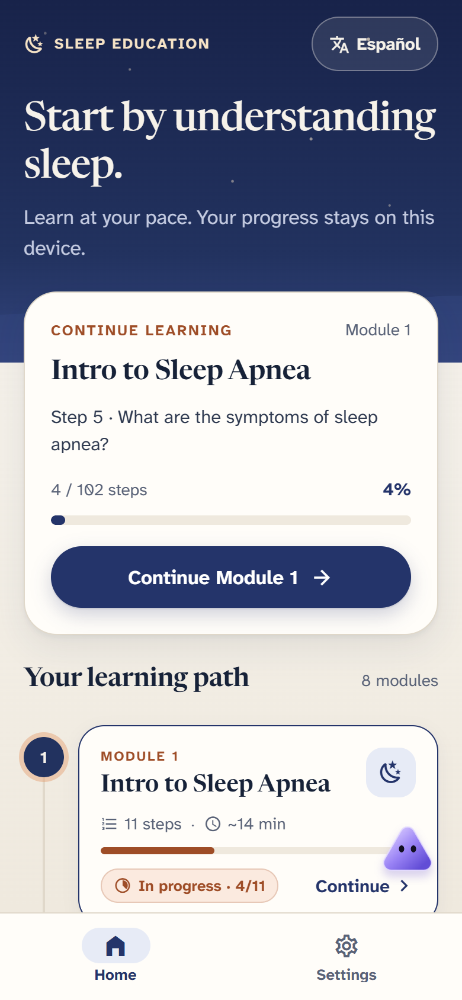
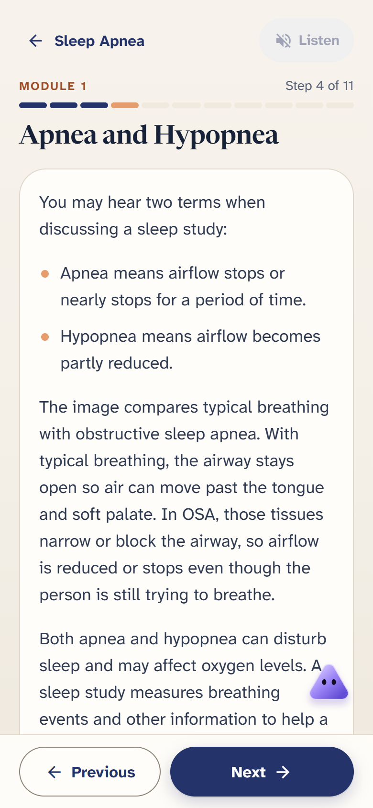
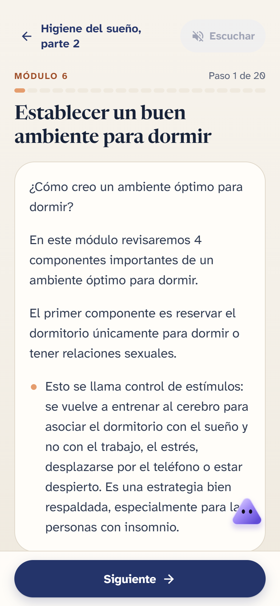

# Sleep Education App

A bilingual (English and Spanish) Expo app that teaches adults about sleep apnea, PAP therapy, pregnancy-related sleep problems, sleep hygiene, and intimacy. Lessons are short screens with knowledge checks and personal reflections, read-aloud narration, and progress that stays on the device.

This is an independent portfolio repository. It is not an official release of any hospital, university, or research program, and none of them sponsors, endorses, or has approved it.

| Home | Lesson | Spanish lesson |
| --- | --- | --- |
|  |  |  |

More captures (module overview, knowledge check, Spanish home, desktop width, AI consent) are in [screenshots/](screenshots/). They use a synthetic progress seed, not learner data.

## What it does

- **8 modules, 102 English screens**, each mirrored in Spanish with the same screen IDs, order, and types. The list is in [docs/curriculum-structure.md](docs/curriculum-structure.md). Healthy Sleep Hygiene is taught in two parts.
- **Learning path.** The home screen lists the modules with progress, status icons plus text labels, and a one-tap English/Español switch.
- **Lessons.** Text with images where reuse is clearly permitted, single- and multi-select knowledge checks with explanations, reflection prompts that are never graded, and a recap per module.
- **Narration.** Uses voices installed on the device or browser. It stops when you leave a screen or change language, and it says so when no voice exists for the chosen language.
- **Progress.** Saved locally (AsyncStorage). Saved progress from earlier versions is migrated when a module is split.
- **Accessibility.** Contrast-checked colors, visible focus, 44 px touch targets, status never shown by color alone, reduced-motion support (system or in-app), and a legibility-focused body font. See [docs/ui-design.md](docs/ui-design.md).
- **Optional AI companion ("Vela").** Off until the learner consents, revocable in Settings, and routed through a small Cloudflare Worker so no provider key is in the app. It is bounded to lesson context, screens for identifying details, and falls back to non-AI guidance. See [docs/ai-safety-boundary.md](docs/ai-safety-boundary.md). The app works fully without it.

## Quick start

Requires Node.js 20 or later.

```text
npm install
npm run web
```

Then open the URL Expo prints (add `--port 19009` to match the test setup). To check the project:

```text
npm run validate:content
npm test
npm run typecheck
npx playwright install chromium   # first time only; the config uses the installed Chrome channel
npm run test:e2e
cd cloudflare-worker && npm install && npm run check
```

The Worker needs a locally created `.dev.vars` with your own provider key to answer real requests. Never commit keys.

## Status and limits

Tested here (automated, run on 2026-11-01): see [docs/verification.md](docs/verification.md) for commands and results.

Not done, and not claimed:

- **No clinical validation.** The lesson text is source-derived educational material and has not been clinically reviewed as part of this repository. The Spanish is drafted, not professionally translated or reviewed. The two new sleep-hygiene module titles and descriptions were written for this change and are unreviewed in both languages.
- **No real-world use.** There are no users, no patient data, no outcome measurements, and no deployment. This is a working prototype and a demonstration.
- **Limited device and accessibility testing.** Checks ran in desktop Chrome at phone and desktop widths. There was no physical-device testing, no screen-reader session with an assistive-technology user, and no usability study. Spanish audible narration and native iOS/Android narration are unverified; browser tests use a stand-in speech engine and check what the app asks it to say.
- **The AI companion is a prototype.** Its Worker has automated tests and was not part of the October interface redesign beyond keeping it working. It is not a clinical tool and must not be used for urgent symptoms or treatment decisions.
- **Public module count is 8.** A private research build has two more PAP modules whose source material is not cleared for public release; they are not included.

## Product and safety boundary

The app gives general education. It is not a diagnostic tool, treatment planner, or clinical decision support, and it does not replace a healthcare professional. It collects no accounts, identifiers, medical records, or free-text symptom histories; reflections stay on the device. Details: [docs/clinical-content-boundary.md](docs/clinical-content-boundary.md).

## My role and AI-assisted development

I (Eli Chang) chose the problem and directed requirements, curriculum structure, bilingual parity rules, privacy and consent boundaries, acceptance criteria, testing scope, and evaluation, and I reviewed defects and results. The implementation was done with AI coding tools (Codex and Claude Code), which I directed and whose output I inspected and corrected. I did not hand-write every line, and I am not claiming independent authorship of the code.

## Assets and license

Source code is MIT licensed ([LICENSE](LICENSE)). Only images with a clear public-domain or Creative Commons basis are bundled; source-derived images with unresolved reuse permission were withheld ([docs/image-sources.md](docs/image-sources.md)). Fonts are Newsreader and Atkinson Hyperlegible Next under SIL OFL 1.1 (license texts in `assets/fonts/`).
