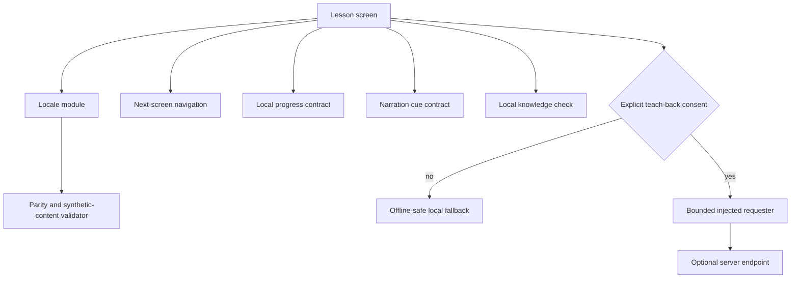

# Architecture

This organization-neutral portfolio edition is a platform-neutral TypeScript reference implementation for a bilingual healthcare-education interface.

The public slice keeps content bundled, progress immutable, and optional network behavior behind an explicit consent boundary. Storage, speech, and server adapters are intentionally represented by small contracts so the core behavior remains deterministic and inspectable.
